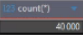

# S1 · Stack Docker, profilage, construction de bronze

Groupe : N°0  ·  Date : 14/10/2026  ·  Rédacteur : AMY Léo  ·  Étiquette : `seance-1`

Rappel : un constat = un chiffre mesuré (règle, couche) + la preuve qui le reproduit + ce que cela change. Voir `README.md`.

## 1. Inventaire des sources (US-01)

| Source | Table | Lignes | Clé primaire | Observation chiffrée |
|---|---|---|---|---|
| crm | client | … | … | … |
| crm | contrat | … | … | … |
| crm | sinistre | … | … | … |
| crm | type_contrat | … | … | … |
| cif | clients | … | … | … |
| cif | compte | … | … | … |
| cif | pays | … | … | … |

Preuve (notebook, requête) : [À COMPLÉTER]

## 2. Bronze et porte B (US-02, US-03)

Méthode d'ingestion en trois lignes (lecture, conversion, métadonnées, relance du lot) : [À COMPLÉTER]

Réconciliation RQ-021 (comptage) et RQ-022 (somme de contrôle), pour le lot mesuré :

| Table bronze | Lignes source | Lignes bronze | Écart de comptage | Écart de somme de contrôle |
|---|---|---|---|---|
| crm_client | 100000 | 100000 | 0 | 100% |
| crm_contrat | 100000 | 100000 | 0 | 100% |
| crm_sinistre | 100000 | 100000 | 0 | 100% |
| crm_type_contrat | 12 | 12 | 0 | 100% |
| cif_clients | 40000 | 40000 | 0 | 100% |
| cif_compte | 45000 | 45000 | 0 | 100% |
| cif_pays | 250 | 250 | 0 | 100% |

Épreuves de la porte (à documenter, avec la preuve de chacune) :

| Épreuve | Résultat obtenu | Preuve |
|---|---|---|
| Relance du même lot : doublons créés | non |  |
| Écart introduit volontairement sur une copie : la porte échoue-t-elle ? | 1 écart | voir diapositive |
| Un problème de conversion rencontré (décimales, NULL, accents) et sa correction | non | … |

## 3. Profil de crm.client (US-06, US-07)

Au moins cinq constats chiffrés.

| N° | Colonne | Indicateur (nulls, vides, distincts, motif…) | Valeur mesurée | Ce que cela change pour la qualité |
|---|---|---|---|---|
| 1 | nom | nulls | 4277 | Cette colonne peut ne pas être fiable |
| 2 | prenom | nulls | 4277 | Cette colonne peut ne pas être fiable |
| 3 | raison_social | nulls | 35723 | Cette colonne n’est pas fiable car extremement vide |
| 4 | pays | vides | 400 | Faible manque par rapport au 100000 lignes |
| 5 | telephone | blancs | 2000 | Faible manque par rapport au 100000 lignes |

Motifs (conformes / non conformes) :

| Attribut | Motif testé | Lignes conformes | Lignes non conformes | Exemple de valeur non conforme |
|---|---|---|---|---|
| Code postal | Code postal à 5 chiffres (RQ-05) | 93981 | 1456 | 7100 (enlève le 0 devant) |
| Téléphone | regex r"(?:"r"0[1-9](?:[ .-]?\d{2}){4}" r"|(?:+|00)[1-9]\d{0,2}(?:[ .-]?\d){6,14}"r")") | 89115 | 886 | 06289748656 |
| Pays | N’est pas dans le référentiel | 97950 | 3050 | Frnace |

Preuve (notebook, requête) : notebooks/S1_bronze_profilage.ipynb

## 4. Dictionnaire du CIF (US-04)

| Colonne d'origine | Nom proposé | Type | Justification chiffrée (comment l'avez-vous déduit ?) |
|---|---|---|---|
| Column0 | IdClient | String | Chaque ligne (40000) est disticte et semble aléatoire |
| Column1 | NomClient | String | Des chaines courtes (3-31), peu distinctes (731), et semblable à des noms |
| Column2 | PrénomClient | String | Des chaines courtes (3-10), peu distinctes (180), et semblable à des prénoms |
| Column3 | DateDeNaissance | Date | Uniquement des chaine de 10 caractères dans le format XX/XX/XXXX |
| Column4 | Adresse | String | Les exemples représente des adresses |
| Column5 | CodePostal | String | Uniquement des chaine de 5 chiffres dans le format XXXXX |
| Column6 | Ville | String | Peu de distincte (172) et des noms de villes dans les exemples (Nice) |
| Column7 | CodePays | String | Peu de distincte (9), et des exemples de ressemblant à des abréviations de pays. Longueurs min et max de 2 (FR) |
| Column8 | NuméroTélephone | String | Colonne entierement distincte sans les nulls, qui est tout le temps dans le format XXXXXXXXXX |
| Column9 | Mail | String | Colonne entierement distincte sans les nulls, et exemples possédants des @ |

## 5. Trois définitions du « client actif » (US-09)

| Direction | Définition utilisée | Nombre de clients | Écart avec la définition de la fiche CD-001 |
|---|---|---|---|
| Commerciale | Un client à au moins un contrat | 50508 | +12459 |
| Sinistres | Un client à un contract actif par rapport à la date de référence | 44116 | +6067 |
| Risques | Un client à un contract actif par rapport à la date de référence et une cotisation sur les trois derniers mois | 38049 | 0 |

Conséquence pour la gouvernance, en trois phrases : Cela empêche la direction d'avoir une vision unifiée du chiffre d'affaires potentiel et de piloter les activités. De plus, cela impose de créer d'urgence un dictionnaire de données  définissant un socle commun tout en documentant ces différentes spécificitées.

## 6. Critères de fin (cochez, avec la preuve si elle n'est pas dans une section ci-dessus)

- [X] Les sept tables bronze existent et chaque ligne porte ses quatre métadonnées.
- [X] La porte B ne montre aucun écart de comptage ni de somme de contrôle.
- [X] Relancer l'ingestion du même lot ne crée aucun doublon.
- [X] Un écart introduit volontairement fait échouer la porte.
- [X] RQ-021 est écrite dans `dq.dq_history` (couche BRONZE).

## 7. Difficultés, écarts avec l'attendu, reprise

Difficultés rencontrées et temps perdu : Lors du S1, nous avons principalement perdue beaucoup de temps, en pensant que nous devions développer nous même les codes pythons. Une fois que nous nous en sommes rendues compte, nous avons pu dérouller le td sans trop de difficulte (à part quelque blocage sur la compréhension des retours demandés).

Point de reprise utilisé (oui / non, lequel) : Non

Ce que nous ferions autrement : Être plus vigilant sur l’ensemble des documents mis à disposition pour avancer sur le TD.
